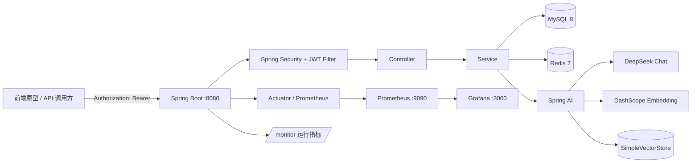

# tlias-web-ai

基于 **Spring Boot 4 + Spring AI** 的智能人事管理系统。在传统 CRUD 与 RBAC 权限体系之上，接入大模型对话、RAG 知识库问答、报表分析与运行监控，并完成容器化编排、数据库版本管理、接口压测与检索评测。

- 在线接口：`http://localhost:8080`
- 默认账号：`admin / 123456`
- Java 21 · Spring Boot 4.1.2 · Spring AI 2.0.2

---

## 1. 技术栈

| 分类 | 技术 |
|---|---|
| 语言 / 运行时 | Java 21 |
| 基础框架 | Spring Boot 4.1.2 |
| AI | Spring AI 2.0.2、DeepSeek Chat、DashScope Embedding、SimpleVectorStore |
| 持久层 | MyBatis 4.0.0、PageHelper 2.1.0、MySQL 8.0 |
| 缓存 | Redis 7 |
| 安全 | Spring Security、JWT（JJWT 0.11.5）、BCrypt |
| 数据库迁移 | Flyway（V1 ~ V5） |
| 监控 | Spring Boot Actuator、Micrometer（p95/p99 直方图）、Prometheus、Grafana、结构化 JSON 日志 |
| 容器化 | Docker、Docker Compose |
| 压测 | k6（阶梯加压 + 假模型高并发 + 故障注入） |
| 其他 | Lombok、阿里云 OSS SDK V2 |

---

## 2. 核心功能

### 2.1 业务与权限
- 部门、员工、班级、学生管理（分页、条件查询、增删改查）。
- RBAC 角色权限：`ADMIN` 可访问报表、知识库重建与运行监控，普通用户仅可访问业务接口。
- JWT 双令牌：Access Token + Refresh Token，支持刷新与退出登录。
- Token 黑名单：退出后的 Access Token 写入 Redis 黑名单，立即失效。
- 登录失败锁定：连续失败达到阈值后短时间锁定，防止暴力破解。

### 2.2 AI 助手
- 基于 SSE 的流式对话接口 `POST /ai/chat`，前端可逐字渲染。
- RAG 知识库问答：文档切分 → DashScope Embedding → 向量检索 → 增强上下文。
- 多轮对话记忆持久化到 Redis，按 `conversationId` 隔离。
- 工具调用（Function Calling）：AI 可查询部门、班级、学生等真实业务数据。
- 接口限流：AI 接口 20 次/分钟，超限返回 429。

### 2.3 报表分析
- 职位人数比例、学生学历分布。
- 每个班级有多少学生。
- 结课预警：30 天内即将结课的班级。
- 违纪排行 TOP10。
- 高危学生清单（违纪扣分 ≥ 5 或违纪次数 ≥ 3）。
- 每个班主任带的学生人数。

### 2.4 运行监控
- 接口延迟按 **p50 / p95 / p99** 统计（Micrometer Timer + 百分位直方图），不再用平均值掩盖长尾。
- 慢接口按 p95 倒序排行，功能使用频次排行。
- AI 指标：并发对话数、总耗时与 **首字延迟（TTFT）** 分位数、知识库命中率/兜底率、Token 消耗、成本估算、限流（429）与兜底次数、success/error/aborted 结果分布。
- 标准化 `/actuator/prometheus` 指标 + Prometheus + Grafana 看板（内置面板，开箱即用）。
- 日志按行输出 JSON 并带 `traceId`，可直接接 Loki / ELK。

---

## 3. 系统架构



请求链路：`JWT 过滤器 → Security 授权 → Controller → Service → MyBatis / Redis / Spring AI`，全链路通过 `traceId` 串联日志。

---

## 4. 目录结构

```text
tlias-web-ai
├─ src/main/java/com/wyh
│  ├─ controller      # 部门、员工、班级、学生、登录、报表、AI、上传、监控
│  ├─ service         # 业务逻辑与 AI 对话、知识库
│  ├─ mapper          # MyBatis Mapper
│  ├─ pojo            # 实体、DTO、统一返回 Result
│  ├─ config          # Security、RAG、Web、Redis、MyBatis 等配置
│  ├─ security        # JWT 过滤器、认证入口、权限拒绝处理
│  ├─ interceptor     # AI 接口限流
│  ├─ aspect          # 操作日志切面
│  ├─ loadtest        # 压测专用假模型（loadtest profile，仅测试环境生效）
│  ├─ monitor         # 指标注册表、请求指标过滤器、/monitor 接口
│  └─ utils           # JWT、BaseContext、Redis 限流等工具
├─ src/main/resources
│  ├─ db/migration    # Flyway：V1 建表 ~ V5 批量演示数据
│  ├─ mapper          # MyBatis XML
│  ├─ logback.xml     # 控制台可读日志 + 文件 JSON 日志（带 traceId）
│  └─ application.yml
├─ src/test/java/com/wyh/RagEvaluationTest.java
├─ loadtest           # k6 阶梯/冒烟/AI 三段式脚本 + 一键压测脚本
├─ tools              # 本地 k6 可执行文件（无需装到 PATH）
├─ config
│  ├─ prometheus.yml  # 抓取配置
│  └─ grafana         # 数据源、看板自动 provision
├─ .github/workflows/ci.yml  # 编译 + 压测冒烟门禁
├─ Dockerfile
├─ docker-compose.yml
└─ .env.example
```

---

## 5. 快速开始

### 5.1 Docker Compose（推荐）

```bash
# 1. 准备环境变量
cp .env.example .env
# 填写 JWT_SECRET（至少 32 字节）、DEEPSEEK_API_KEY、DASHSCOPE_API_KEY

# 2. 构建并启动
docker compose up -d --build

# 3. 健康检查
curl http://localhost:8080/actuator/health
```

启动后：

| 服务 | 宿主机端口 | 说明 |
|---|---|---|
| 应用 | `8080` | Spring Boot（prod profile） |
| 压测实例 | `8081` | `docker compose --profile loadtest up -d app-loadtest`，假模型、不花钱 |
| MySQL | `3307` → 容器 3306 | 若本机 3306 已被占用，Compose 映射到 3307 |
| Redis | `6379` | |
| Prometheus | `9090` | 指标存储，抓取 `/actuator/prometheus` |
| Grafana | `3000` | `admin / admin`，看板已自动导入 |

> 数据库连接：`localhost:3307`，用户 `root`，密码见 `.env` 中的 `MYSQL_ROOT_PASSWORD`，库名 `alias`。
> 用 DataGrip / Navicat 连 **3307** 才能看到应用数据；连 3306 看到的是本机 MySQL。

### 5.2 本地运行

前置条件：JDK 21、MySQL 8（库 `alias`）、Redis 7。

```bash
# Windows
$env:JWT_SECRET="至少32字节的随机字符串"
$env:DEEPSEEK_API_KEY="..."
$env:DASHSCOPE_API_KEY="..."

# macOS / Linux
export JWT_SECRET="..."
export DEEPSEEK_API_KEY="..."
export DASHSCOPE_API_KEY="..."

./mvnw spring-boot:run
```

Flyway 会在启动时自动执行迁移脚本，无需手动建表。

### 5.3 环境变量

| 变量 | 必填 | 说明 |
|---|---|---|
| `JWT_SECRET` | 是 | JWT 签名密钥，长度 ≥ 32 字节 |
| `DEEPSEEK_API_KEY` | 是 | DeepSeek 对话模型 |
| `DASHSCOPE_API_KEY` | 是 | DashScope Embedding |
| `MYSQL_ROOT_PASSWORD` | Compose | MySQL root 密码 |
| `DB_URL` / `DB_USERNAME` / `DB_PASSWORD` | Compose | 容器内数据库连接 |
| `REDIS_HOST` | Compose | 容器内 Redis 地址 |

---

## 6. 接口一览

统一返回结构：`{ "code": 1, "msg": "success", "data": ... }`，`code=1` 表示成功。

认证方式：`Authorization: Bearer <accessToken>`。

| 模块 | 方法 | 路径 | 说明 |
|---|---|---|---|
| 登录 | POST | `/login` | 登录，返回 `token` 与 `refreshToken` |
| 登录 | POST | `/refresh` | 刷新 Access Token |
| 登录 | POST | `/logout` | 退出并拉黑当前 Token |
| 部门 | GET/POST/PUT/DELETE | `/depts` | 部门 CRUD |
| 员工 | GET/POST/PUT/DELETE | `/emps` | 员工分页与 CRUD |
| 班级 | GET/POST/PUT/DELETE | `/clazzs` | 班级 CRUD |
| 学生 | GET/POST/PUT/DELETE | `/students` | 学生分页、CRUD、违纪登记 |
| 报表 | GET | `/report/empJobData` | 职位人数比例 |
| 报表 | GET | `/report/studentEducationData` | 学生学历分布 |
| 报表 | GET | `/report/clazzStudentCount` | 每个班级学生人数 |
| 报表 | GET | `/report/clazzFinishWarning` | 30 天内结课预警 |
| 报表 | GET | `/report/violationRanking` | 违纪排行 TOP10 |
| 报表 | GET | `/report/highRiskStudents` | 高危学生清单（上限 50） |
| 报表 | GET | `/report/masterStudentCount` | 每个班主任带生人数 |
| AI | POST | `/ai/chat` | SSE 流式对话 |
| AI | DELETE | `/ai/chat/{conversationId}` | 清除会话记忆 |
| AI | POST | `/ai/knowledge/rebuild` | 重建向量库（ADMIN） |
| 监控 | GET | `/monitor/overview` | 接口耗时 / 使用频次（ADMIN） |
| 监控 | GET | `/monitor/ai` | AI 指标（ADMIN） |
| 运维 | GET | `/actuator/health` | 健康检查 |
| 运维 | GET | `/actuator/prometheus` | Prometheus 指标 |

示例：

```bash
TOKEN=$(curl -s -X POST http://localhost:8080/login \
  -H "Content-Type: application/json" \
  -d '{"username":"admin","password":"123456"}' | jq -r '.data.token')

curl http://localhost:8080/report/clazzStudentCount \
  -H "Authorization: Bearer $TOKEN"
```

---

## 7. AI 与 RAG

- 向量化：DashScope Embedding，将知识库文档切分后写入 `SimpleVectorStore`，持久化到 `data/vector-store.json`。
- 检索参数：`topK=3`、相似度阈值 `0.35`。
- 多轮记忆：`MessageChatMemoryAdvisor` + Redis，按 `conversationId` 保存历史消息。
- 查询改写：多轮追问使用 `CompressionQueryTransformer` 改写为可独立检索的问题。
- 兜底：未命中知识库时由大模型基于通用能力回答，不阻断对话。

### RAG 检索评测

评测脚本：[RagEvaluationTest.java](src/test/java/com/wyh/RagEvaluationTest.java)，评测集为 24 道带标准来源的问题，指标为 Recall@1、Recall@3、MRR。

```bash
./mvnw test -Dtest=RagEvaluationTest
```

| 相似度阈值 | Recall@1 | Recall@3 | MRR |
|---|---|---|---|
| 0.50 | 95.83% | 95.83% | 0.958 |
| **0.35（当前）** | **100%** | **100%** | **1.000** |

报告输出：`target/rag-eval-report.md`。

---

## 8. 运行监控

监控分三层，三者互补：

| 层 | 位置 | 用途 |
|---|---|---|
| 应用指标 | `/actuator/prometheus`（Micrometer） | 分位数、错误率、饱和度，长期留存与告警 |
| 业务视图 | `/monitor/overview`、`/monitor/ai` | 前端监控页，进程内实时快照 |
| 日志 | `logs/tlias-*.json.log` | 带 `traceId` 的单请求链路排查 |

### 8.1 关键指标

| 指标 | 说明 |
|---|---|
| `tlias_http_requests_seconds_*` | 接口耗时，**开了百分位直方图**，可算 p50/p95/p99 |
| `tlias_http_responses_total{status}` | 按状态码的响应数，用于算 5xx 错误率 |
| `tlias_ai_chat_seconds_*` | AI 对话总耗时（标签 `model`） |
| `tlias_ai_chat_ttft_seconds_*` | **首字延迟（TTFT）**，流式体验的核心指标 |
| `tlias_ai_requests_total{outcome}` | success / error / aborted / rate_limited 分布 |
| `tlias_ai_tokens_total{type}` | prompt / completion token 速率 |
| `tlias_ai_cost_total` | 按配置单价估算的累计成本（元） |
| `tlias_ai_kb_retrieval_total{result}` | RAG 命中 / 未命中 |
| `tlias_ai_ratelimited_total`、`tlias_ai_fallback_total{reason}` | 限流与兜底次数 |
| `tlias_ai_inflight` | 当前并发对话数 |

> **不要只看平均值**：平均值会被长尾掩盖。压测判据一律用分位数，例如
> `histogram_quantile(0.95, sum by (le) (rate(tlias_http_requests_seconds_bucket[5m])))`。

### 8.2 Prometheus + Grafana

```bash
docker compose up -d prometheus grafana
```

- Prometheus：<http://localhost:9090>（抓取间隔 5s，配置见 `config/prometheus.yml`）
- Grafana：<http://localhost:3000>（`admin / admin`，看板已自动导入：**Tlias 运行监控（HTTP + AI）**）
- 抓取目标两个：`prod`（8080 正常实例）与 `loadtest`（8081 压测实例）

看板内置 11 个面板：QPS、5xx 错误率、AI 并发数、接口 p95/p99、AI 总耗时与首字 p95、结果分布、Token 速率、成本速率、429/兜底、连接池等待与 Tomcat 忙线程、JVM 堆。

### 8.3 日志

- 控制台：可读文本，包含 `traceId`。
- 文件：每行一个 JSON（`logs/tlias-yyyy-MM-dd-N.json.log`），带 `app`、`traceId`、异常堆栈，可直接被 Loki / ELK 采集。
- `traceId` 来自 `TraceIdFilter`，并通过响应头 `X-Trace-Id` 返回，前端报障时带上它即可定位整条链路。
- 压测期间日志用异步 appender 写盘（8k 队列、不阻塞业务），避免日志本身成为瓶颈。

### 8.4 成本口径

单价可通过 `tlias.ai.cost.input-per-million`、`tlias.ai.cost.output-per-million` 配置（元/百万 token，默认 2 / 8）。
`loadtest` profile 下单价置 0，避免假模型的成本污染真实成本曲线。

---

## 9. 压测

### 9.1 为什么不能只用一种压测

业务接口可以随便压，AI 接口不行：真实模型有 **供应商限流、网络抖动、按 token 计费**，压 50 并发既烧钱又复现不了问题。所以分四类：

| 类型 | 目标 | 并发 | 成本 |
|---|---|---|---|
| 业务接口 | 找吞吐拐点、验证索引与连接池 | 50 → 200 VU 阶梯 | 0 |
| AI 链路（假模型） | 压自己代码：拦截器、Redis 记忆、RAG 检索、SSE 转发 | 20 VU 起 | 0 |
| AI 端到端（真模型） | 真实 TTFT / p95 / 单次成本 | 1~3 VU | 真实计费 |
| 故障注入 | 验证 429 / 超时 / 断流的兜底与重试 | 1 VU | 0 |

### 9.2 业务接口：阶梯加压

```bash
tools/k6/k6-v2.4.0-windows-amd64/k6.exe run -e BASE_URL=http://localhost:8081 loadtest/k6.js
tools/k6/k6-v2.4.0-windows-amd64/k6.exe run -e STAGE=spike loadtest/k6.js   # 尖刺
tools/k6/k6-v2.4.0-windows-amd64/k6.exe run -e STAGE=soak  loadtest/k6.js   # 浸泡
```

- 标准场景 50 → 100 → 200 VU，每档稳态 2 分钟，看 **p99 与错误率随负载变化的拐点**，不要只看一次 10 VU 的结果。
- 阈值门禁：`p(95)<300ms`、`p(99)<800ms`、失败率 < 1%，不达标 k6 以非 0 退出。

### 9.3 AI 链路：三段式

```bash
pwsh loadtest/run-loadtest.ps1 -Mode mock                                  # 假模型，高并发
pwsh loadtest/run-loadtest.ps1 -Mode real -BaseUrl http://localhost:8080   # 真模型，1~3 VU
pwsh loadtest/run-loadtest.ps1 -Mode fault                                 # 故障注入
```

假模型来自 `com.wyh.loadtest.MockAiConfig`，只在 `loadtest` profile 生效：

- 流式返回固定分片（默认 30 块 × 20ms，可配 `tlias.loadtest.*`），模拟真实流式节奏。
- 最后一块带 usage，Token 与成本链路照常工作。
- 故障由开关注入：`POST /loadtest/fault?mode=429|timeout|abort|none`（仅 loadtest profile 存在）。
  不用"消息里带标记"，因为 RAG 的查询改写会把用户消息重写，标记到不了模型。
- 向量模型替换为哈希假向量，RAG 检索链路照常执行，不请求 DashScope。
- 该 profile 同时放开限流（`tlias.ai.rate-limit.*`），否则 20 次/分钟根本压不起来。

```bash
# 故障注入示例
curl -X POST "http://localhost:8081/loadtest/fault?mode=abort" -H "Authorization: Bearer $TOKEN"
k6 run -e MODE=fault -e FAULT=abort loadtest/k6-ai.js
```

> k6 默认会把系统环境变量并入 `__ENV`，而 Windows 自带 `USERNAME`（系统登录名），
> 所以脚本里的账号变量统一加了前缀：`TLIAS_USER` / `TLIAS_PASSWORD` / `TLIAS_BASE_URL`。

> 客户端 `res.timings.waiting` 只是首字节近似值；**TTFT 以服务端 `tlias_ai_chat_ttft_seconds` 为准**。

### 9.4 一键脚本

```powershell
pwsh loadtest/run-loadtest.ps1 -Mode mock -Stage standard
```

流程：构建镜像 → 起 mysql/redis → 起 `app-loadtest`（8081）→ 等健康检查 → 跑 k6 → 透传退出码。

### 9.5 服务端指标采集

```powershell
powershell -ExecutionPolicy Bypass -File .\loadtest\collect-server-metrics.ps1 -DurationSeconds 90
```

每 3 秒采样 `/monitor/overview`、`/monitor/ai` 与 `docker stats`，输出 `loadtest/server-metrics.csv`，作为压测当场留档；长期曲线看 Grafana。

### 9.6 基线与对比

不要只报一次绝对值，要报**同一脚本、同参数、改前/改后**的对比：

| 指标 | 旧基线（10 VU / 40s） | 新流程 |
|---|---|---|
| 负载方式 | 单档 10 VU | 50 → 200 VU 阶梯，每档 2 分钟 |
| 请求数 | 2611 | k6 摘要 |
| 失败率 | 0.00% | k6 摘要（阈值 < 1%） |
| 平均耗时 | 16.65 ms | 仅供参考 |
| P95 / P99 | 43.47 ms / — | **以 Grafana 分位数为准** |
| 吞吐 | 63.6 req/s | 拐点处吞吐 |

### 9.7 CI 门禁

`.github/workflows/ci.yml`：

1. `build`：JDK 21 编译打包；
2. `loadtest-smoke`：起 mysql/redis/压测实例，跑 `loadtest/k6-smoke.js`（2 VU / 30s，`p(95)<800ms`、失败率 < 1%），**不达标即中断流水线**，防止重构悄悄把性能搞坏。

---

## 10. 数据库迁移

Flyway 脚本位于 `src/main/resources/db/migration`：

| 版本 | 内容 |
|---|---|
| V1 | 基础表结构（dept、emp、clazz、student、operate_log 等） |
| V2 | RBAC 角色字段、密码字段 |
| V3 | 初始化部门与管理员账号 `admin / 123456` |
| V4 | 报表演示数据（班级、学生、班主任、违纪记录） |
| V5 | 批量演示数据：员工 100、班级 50、学生 8012 |

首次启动自动执行；已执行的版本不会重复执行。

> 本项目为求职演示项目，包含演示数据。生产环境请删除或调整 V4 / V5。

---

## 11. 常见问题

**Q：DataGrip 连上后看不到新数据？**
A：应用使用的是 Docker 内的 MySQL，宿主机端口映射为 **3307**。请连接 `localhost:3307`（库 `alias`），而不是本机 3306。

**Q：请求一直 401？**
A：本项目的认证已统一为标准 `Authorization: Bearer <token>`，不再兼容自定义 `token` 请求头。

**Q：前端直接双击 HTML 打开能调通接口吗？**
A：可以。后端已开启 CORS，允许本地 `file://` 页面直连 `http://localhost:8080`。

**Q：Docker 启动后 MySQL 端口为什么是 3307？**
A：避免与本机已安装的 MySQL（3306）冲突。如需改回 3306，先停本机 MySQL，再修改 `docker-compose.yml` 的端口映射。

---

## 12. 项目亮点（简历可写）

- 基于 Spring AI 实现 RAG 知识库问答，使用 DashScope Embedding + 向量检索，通过 24 题评测集将 Recall@1 从 95.8% 优化至 100%，MRR 提升至 1.000。
- 基于 Spring Security + JWT 实现 RBAC、双令牌刷新、Redis 黑名单与登录失败锁定。
- 使用 Flyway 管理 5 个版本数据库迁移，Docker Compose 一键编排 MySQL / Redis / 应用，支持健康检查与自动重启。
- 使用 k6 对容器化服务压测：10 并发下 P95 43ms、错误率 0%，并通过自建监控接口与采集脚本观测服务端 CPU、内存、Token 与限流指标。
- 实现 AI 可观测性：知识库命中率/兜底率、首字延迟、平均响应、Token 成本估算与限流次数。
